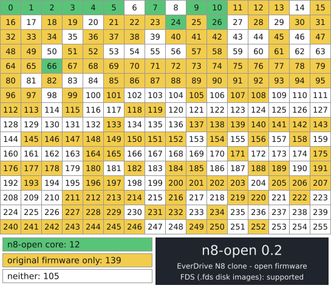

# n8-open

Open firmware for the EverDrive N8 clone cartridge (NES, 72-pin): menu,
loader and FPGA mapper cores, written from scratch.

The cartridge: Altera Cyclone II EP2C5 (mapper cores), MAX II CPLD (bus
glue, SD card, FPGA configuration), 512 KB PRG and CHR SRAM, battery-backed
save SRAM (a 256 KB chip of which 128 KB are reachable), the BIOS in flash. n8-open replaces what lives on
the SD card - `/EDFC/OS.BIN`, `/EDFC/MAPROUT.BIN` and `/EDFC/MAPS/*.RBF`;
the cartridge's own BIOS stays as it is and starts it.

## Caveat: the BIOS

The BIOS in the clone's flash is most likely an older version of Krikzz's
original firmware: on the cartridge n8-open was developed on, its error
screen (missing files) points to Krikzz's website. n8-open deliberately
leaves it untouched - reflashing it risks bricking the cartridge, and
recovery would need a programmer or JTAG. So n8-open depends on that BIOS
to load `OS.BIN` and the cores from the SD card; what is known about it is
in `docs/hw-interface.md`.

## Status

Generated from `cores/cores.txt` and `docs/mappers.md` by
`python tools/mk_assets.py`; details per mapper: `docs/mappers.md`.

| | |
|---|---|
| Menu | browse (FAT32, long names, sorted), ROM info, game start, battery saves to SD |
| Menu core | `255.RBF` |
| NROM (0) | `100.RBF` |
| MMC1 (1) | `101.RBF` |
| UxROM (2) | `102.RBF` |
| CNROM (3) | `103.RBF` |
| MMC3 (4) | `104.RBF` |
| MMC5 (5) | `105.RBF` - banking, ExRAM, fill mode, scanline IRQ, extended attributes, split screen, audio (2 pulses + PCM on `cpu_exp`); saves 8 KB only |
| AxROM (7) | `107.RBF` |
| MMC2 (9), MMC4 (10) | `109.RBF`, `110.RBF` - CHR latches ($FD/$FE tiles); MMC4 with PRG RAM |
| VRC2 / VRC4 (21, 22, 23, 25) | `121.RBF`, `122.RBF`, `123.RBF`, `125.RBF` - banking, IRQ, both address wirings per mapper |
| VRC6 (24, 26) | `124.RBF`, `126.RBF` - banking, IRQ, audio (2 pulses + saw on `cpu_exp`) |
| GxROM (66) | `166.RBF` |
| Sunsoft FME-7 (69) | `169.RBF` - banking, CPU-cycle IRQ (with the NTSC-on-PAL correction); no 5B audio yet |
| Camerica / Codemasters (71) | `171.RBF` - incl. Fire Hawk's one-screen mirroring |
| Color Dreams (11) | `111.RBF` |
| BNROM / NINA-001 (34) | `134.RBF` - both boards in one core |

Expansion audio was tested on an original N8 (all of it plays) and one
clone, whose board only passes part of it (low tones yes, higher tones no).
Other clones may differ.

Full list (the 151 mappers the original firmware supports, with our
status per mapper): `docs/mappers.md`.

Planned: MMC5 saves > 8 KB. Open items
and test results: `BACKLOG.md`.

## NTSC games on PAL consoles

Many NTSC games (USA, Japan) lose their status bar on a PAL console: the
PAL vblank is about 50 lines longer and a line has fewer CPU cycles, so
splits timed for NTSC fire too early. n8-open corrects this where it can:

- The menu measures the console's region at power-on (NTSC, PAL or Dendy)
  and reads the game's region from the NES 2.0 header, the iNES PAL flag or
  the file name ("(Europe)", "(E)", "(PAL)"; otherwise NTSC).
- For an NTSC game on a PAL console, cores with CPU-cycle IRQs (VRC6 so
  far) count PAL lines and skip the extra vblank time. Example: Akumajou
  Densetsu's status bar.
- Games whose own code times out get a small patch while loading, from a
  verified list (`menu/src/region.s`); the ROM file is not changed, and the
  patch is only applied if every original byte at the spot matches.
  Example: Castlevania (USA).
- The info screen (Select) shows `REGION   NTSC ON PAL NES: FIX` when this
  applies. Holding B while starting the game with A turns it off.

What it cannot change: the game runs at 50 instead of 60 frames per second
(slower game and music), and timing problems in games not covered by the
list. MMC3 games count real PPU lines and need no correction.

## Layout

| Path | |
|---|---|
| `menu/` | the menu, 6502 assembly (cc65) - see `menu/README.md` |
| `cores/nrom/` | all game cores (one Quartus revision per mapper) - see `cores/nrom/README.md` |
| `cores/nrom_noret/` | the menu core `255.RBF` |
| `cores/tb/` | Icarus Verilog testbenches |
| `cores/cores.txt` | mapper -> core table, turned into `MAPROUT.BIN` |
| `tools/` | simulator, SD image and FAT tools, `MAPROUT.BIN` and RBF helpers |
| `docs/` | hardware interface and pinout as found, testing |

## Building

- Cores: Quartus II 13.0 SP1 Web Edition (the last version with Cyclone II).
  Open `cores/nrom/n8_nrom.qpf`, pick the revision, compile, then
  `python tools/pad_rbf.py cores/nrom/output_files/<revision>.rbf <NNN> <card>/EDFC/MAPS`.
- Menu: cc65, `menu/build.bat` -> `menu/build/OS.BIN`.
- `MAPROUT.BIN`: `python tools/mk_maprout.py cores/cores.txt <card>/EDFC/MAPROUT.BIN`.
- Tests: Icarus Verilog 12 and Python 3, see `docs/testing.md`.

## How it is written

The cores and the menu are written from public documentation (NESdev wiki)
and from measurements and analysis of the hardware; no code from the
original firmware or from other cores is used. Where the documentation
leaves a detail open, the source says what was inferred and how it was
confirmed.

No game ROMs, BIOS images or firmware dumps are part of this repository.

## License

n8-open is free software: you can redistribute it and/or modify it under
the terms of the GNU General Public License as published by the Free
Software Foundation, either version 3 of the License, or (at your option)
any later version. See `LICENSE`.

Whoever distributes built cores (`.RBF`) or menus (`OS.BIN`) must offer the
corresponding sources under the same terms.
